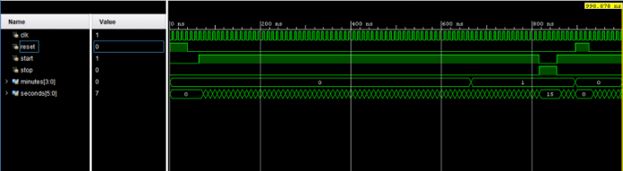
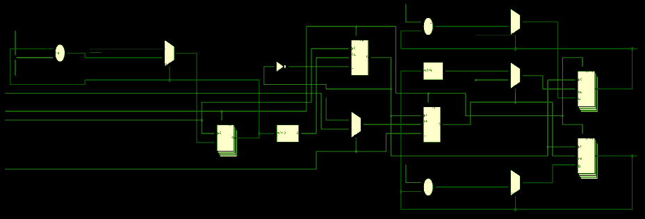
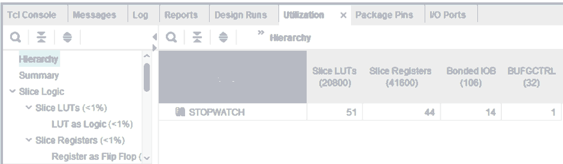

# FPGA Digital Stopwatch

A digital stopwatch implemented in SystemVerilog using **Xilinx Vivado** and an **Artix-7 FPGA**. The project includes the hardware RTL, a faster simulation variant, a behavioral testbench, and board constraints transcribed from the project report.

## Features

- Start and stop controls
- Active-high asynchronous reset
- Clock division for real-time hardware operation
- Seconds counter from 0 to 59
- Minutes counter from 0 to 9 (10-minute range, then wraps to 00:00)
- Separate fast simulation design for quick behavioral verification
- Vivado waveform, RTL schematic, synthesized schematic, and utilization evidence

## Repository structure

```text
fpga-digital-stopwatch/
├── README.md
├── rtl/
│   ├── stopwatch.sv
│   └── stopwatch_sim.sv
├── sim/
│   └── stopwatch_tb.sv
├── constraints/
│   └── stopwatch.xdc
└── docs/
    ├── implementation-notes.md
    ├── vivado-simulation-waveform.png
    ├── rtl-schematic.png
    ├── synthesized-schematic.png
    └── utilization-report.png
```

## Hardware design

The FPGA hardware module is `STOPWATCH` in `rtl/stopwatch.sv`. Its clock divider toggles `clk_div` after 50,000,000 input-clock cycles. With a 100 MHz input clock, this gives a 1 Hz rising-edge tick for the stopwatch counters. While running, seconds increment from 0 through 59; at rollover, seconds return to zero and minutes increment. After minute 9, the counter wraps back to 00:00.

Inputs:
- `clk`: board clock
- `reset`: active-high asynchronous reset
- `start`: starts/resumes counting
- `stop`: pauses counting

Outputs:
- `minutes[3:0]`: minute count
- `seconds[5:0]`: second count

## Vivado simulation waveform

This is the simulation waveform screenshot shared from the original project. It shows the clock, reset, start/stop controls, and minute/second outputs in the Vivado waveform viewer.



## RTL schematic

The RTL schematic generated by Vivado illustrates the synthesized RTL-level structure and connections between the stopwatch logic blocks.



## Synthesized schematic

The synthesized schematic shows the mapped logic structure generated by Vivado synthesis.


## FPGA utilization report

The utilization screenshot from the project report shows the reported use of **51 Slice LUTs**, **44 Slice Registers**, **14 Bonded IOBs**, and **1 BUFGCTRL** for the `STOPWATCH` design.



## Run behavioral simulation in Vivado

The file `rtl/stopwatch_sim.sv` intentionally omits the hardware clock divider so the counters can be tested quickly: each rising edge of `clk` acts as one timing tick. This simulation-only module is **not** the top-level module to program onto the FPGA.

1. Open or create the RTL project in Xilinx Vivado.
2. Add `rtl/stopwatch_sim.sv` and `sim/stopwatch_tb.sv` as simulation sources.
3. Set `stopwatch_tb` as the simulation top.
4. Select **Run Simulation → Run Behavioral Simulation**.
5. Add `clk`, `reset`, `start`, `stop`, `minutes`, and `seconds` to the waveform view.

The screenshots above are the original project screenshots; the waveform has not been regenerated from the repository files here.

## Vivado FPGA implementation

1. Create or open a Vivado project for the exact Artix-7 device on your board.
2. Add `rtl/stopwatch.sv` and select `STOPWATCH` as the top module.
3. Add `constraints/stopwatch.xdc`.
4. Confirm the board clock frequency and verify every package pin against the exact board's official master constraints before generating a bitstream.
5. Run synthesis and implementation, then program the FPGA.

**Hardware note:** The divider value `49_999_999` assumes a 100 MHz input clock. The report text does not identify the exact Artix-7 board model, so verify the XDC pin assignments before hardware use and add a `create_clock` timing constraint matching the actual clock.

## Notes

- The hardware version with clock division is intended for FPGA operation; the no-divider version is for quicker Vivado simulation.
- Pin mappings in the XDC were transcribed from the provided report and are not guaranteed to fit every Artix-7 board.
- The source and testbench in this repository are organized from the project report. Re-run the Vivado simulation and synthesis in your own project to validate the checked-in files.
